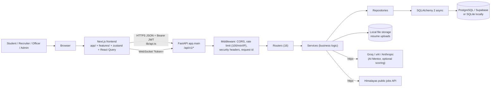
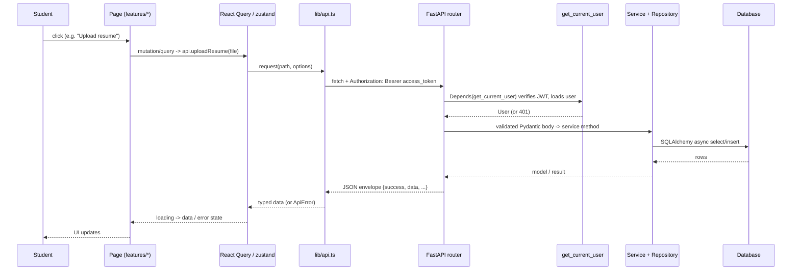
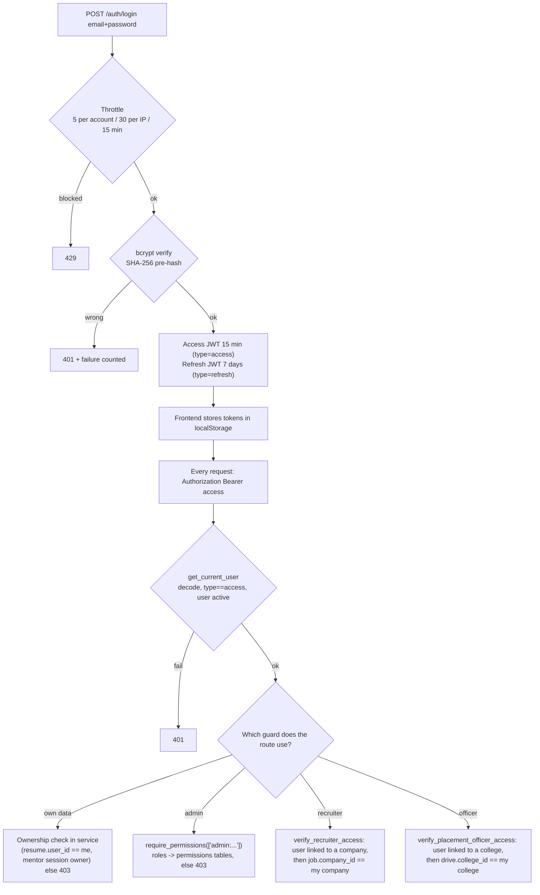
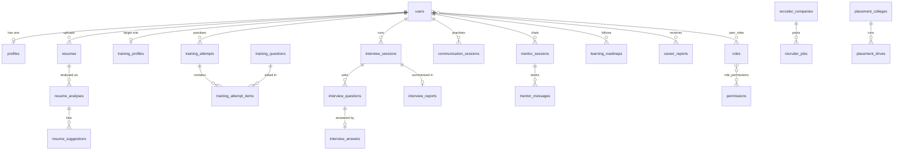

# Career OS - Technical Architecture (from the real code)

All diagrams are Mermaid (they render on GitHub and in most Markdown viewers). Facts were read from the repository on 2026-10-27; nothing was inferred from file names alone.

---

## 1. Directory map

```
carrer-os/
├── frontend/                       Next.js 15 app (TypeScript, Tailwind 4)
│   ├── app/
│   │   ├── page.tsx                Landing page
│   │   ├── (auth)/                 login, register, forgot-password, otp-verification (the last two are honest "not available" pages)
│   │   └── (dashboard)/            All logged-in pages (layout.tsx = sidebar + top nav + floating mentor)
│   ├── features/                   The real screens: student/, recruiter/, officer/, admin/, community/, mentor/, platform/
│   ├── components/ui/              Shared UI: button, card, dialog, tabs, sidebar, top-nav, feedback (loading/error)
│   ├── lib/api.ts                  THE centralised API client (typed, token refresh, error mapping)
│   ├── lib/useSessionSocket.ts     WebSocket hook for live interview / communication
│   ├── store/                      zustand: useAuthStore, useMentorStore, useNotificationStore
│   └── **/__tests__/               vitest tests (44)
├── careeros_backend/               FastAPI app
│   ├── app/main.py                 App factory: middleware, exception handlers, router registration, health, metrics
│   ├── app/core/                   config.py, security.py (JWT + bcrypt), dependencies.py (auth/RBAC), login_throttle.py,
│   │                               text_analysis.py (shared rule-based NLP), safety.py (remote-DB guards), middleware/, exceptions.py
│   ├── app/db/                     base.py (Base + AuditableBase), session.py (async engine/session)
│   ├── app/infrastructure/         storage/local_storage.py (real), s3_client.py (stub), cache/redis.py (stub)
│   ├── app/modules/<name>/         One folder per feature: router.py, service.py, repository.py, models.py, schemas.py
│   ├── scripts/                    seed_dev.py, create_supabase_schema.py, e2e_live.py (live probes; remote-DB guarded)
│   ├── tests/                      pytest (api, unit, services, repositories, websocket, smoke, training)
│   ├── deployment/ docker/ *.yml   Kubernetes manifests, nginx/prometheus/grafana configs, compose files (NOT run in this audit)
│   └── requirements.txt
├── e2e/                            Node e2e scripts (roles.e2e.mjs, student.e2e.mjs) - not run in this audit
├── review_docs/                    This documentation
└── README.md
```

Backend modules (`app/modules/`): `auth`, `users`, `resumes`, `jobs`, `recommendations`, `interviews`, `training`, `communication`, `career_discovery`, `mentor`, `learning`, `placements`, `recruiters`, `community`, `analytics`, `admin`, `audit`, `ai`.

## 2. Overall system architecture



## 3. Frontend-to-backend request flow


If the server answers 401, `api.ts` calls `POST /auth/refresh` once with the stored refresh token, retries the request, and if that also fails clears the tokens and sends the user to login.

## 4. Authentication and authorization flow


WebSockets cannot send headers from browsers, so `get_user_from_token` validates `?token=` inside the handler and the session ownership is checked before accepting events.

## 5. Backend module-by-module map

| Module | Router prefix | Main responsibilities (real files) |
|---|---|---|
| auth | `/auth` | `router.py` (login/register/refresh/me), `service.py` (hashing, tokens), `repository.py`; models `User`, `Role`, `Permission`, `user_roles`, `role_permissions` |
| users | `/users` | profile read/update (`/users/me/profile`), education, skills, projects |
| resumes | `/resumes` | `upload_validation.py` -> `text_extraction.py` -> `analysis.py` (rule-based scoring) -> `service.py` (background task, ownership) -> download |
| jobs | `/jobs` | `service.py` calls the Himalayas API with timeouts/caching; `skills.py` reads the student's skills for matching |
| recommendations | `/recommendations` | `context_aggregator.py` (reads many modules), `recommendation_engine.py` (rules), `ranking_engine.py`, feedback |
| training | `/training` | Interview Preparation: `bank/` (187 questions), `scoring.py`, `progress.py`, `generation.py`, `llm.py` (provider client), `service.py`, `router.py` |
| interviews | `/interviews` | REST sessions/report + WebSocket `/ws/{id}`; `evaluation_engine.py` reuses the training rubric |
| communication | `/communication` | REST + WebSocket; `evaluation_engine.py` (text metrics) |
| career_discovery | `/discovery` | assessment templates, submit, report (`ai_engine.py` is an answer-tally algorithm) |
| mentor | `/mentor` | sessions, messages, goals, status, suggestions; `prompt.py` (system prompt), `service.py` (LLM call + errors) |
| learning | `/learning` | roadmap generation (`roadmap_engine.py`), active roadmap, complete task |
| placements | `/placements` | colleges, drives, eligibility, ranking (`student_ranking_service.py`), registrations, offers |
| recruiters | `/recruiters` | company, jobs, applications, candidate matching (`matching_engine.py`) |
| community | `/community` | posts, comments, reactions, search |
| analytics | `/analytics` | student dashboard, events, AI-usage log |
| admin | `/admin` | 35 routes: users, roles, permissions, audit, announcements, monitoring, AI provider config |
| audit | - | `AuditService.log_action` called by other services |
| ai | - | `orchestrator.py` + `echo_gateway.py` (**stub** used by the admin "test provider" screen) |

**Layering rule:** the router only validates input and calls a service; the service holds business rules and ownership checks; the repository runs SQLAlchemy queries; Pydantic **schemas** describe what crosses the API, SQLAlchemy **models** describe tables. (Some modules, e.g. mentor, keep light logic in the router or call the repository from it; this is a style inconsistency, not a bug.)

## 6. One complete request lifecycle: "Send a message to the AI Mentor"

1. User types in the widget (`features/mentor/components/mentor-chat-parts.tsx` -> `MentorComposer`) and presses Enter.
2. `useMentorStore.sendMessage` adds the message locally, then `deliver()` calls `api.sendMentorMessage(sessionId, text)`.
3. `lib/api.ts` sends `POST /api/v1/mentor/sessions/{id}/message` with `{content}` and the Bearer token.
4. Middleware: request id, rate limit, security headers, CORS. Router `mentor/router.py: send_message`.
5. FastAPI validates the body with `ChatMessageRequest` (1-4000 characters, not blank) -> 422 otherwise; `get_current_user` authenticates.
6. `MentorService.send_message`: loads the session and **checks `session.user_id == current user`** (403 otherwise); applies a per-user limit (12/min -> 429).
7. `_reply`: if no AI key -> 503 setup message. Otherwise `ContextAggregator` reads this user's own records and `prompt.build_system` formats verified facts inside `<user_facts>`; the last 10 messages are added as history.
8. `llm.complete_text` sends the request to the provider with `httpx` (25 s timeout). Provider errors become typed reasons mapped to 429/502/503/504 with safe messages.
9. Only on success: the user message and the assistant message are inserted (`mentor_messages`), an audit row is written, and the assistant message is returned in the envelope.
10. The store appends the reply; React re-renders; the failed state (with Retry) is shown instead if any step failed.

## 7. Database overview (actual models)

* Engine: SQLAlchemy 2 async. `DATABASE_URL` is rewritten to `postgresql+asyncpg://` for PostgreSQL; local mode uses `sqlite+aiosqlite`. `get_db()` yields one `AsyncSession` per request.
* 103 tables / 78 foreign keys / 54 named indexes. UUID primary keys everywhere; `AuditableBase` provides `created_at`, `updated_at`, `deleted_at` (a soft-delete column; only some repositories, mostly the admin ones, filter on it - the rest do not, so "delete" is not uniformly soft).
* Table groups: identity/RBAC (`users`, `roles`, `permissions`, `user_roles`, `role_permissions`, `refresh_tokens` [unused], `login_history`, `user_sessions`), profile (`profiles`, `educations`, `experiences`, `projects`, `profile_skills`, `skills`, `certifications`), resume (`resumes`, `resume_versions`, `resume_metadata`, `resume_analyses`, `resume_suggestions`), training (`training_questions`, `training_profiles`, `training_attempts`, `training_attempt_items`), interviews/communication, discovery, learning, recommendations, mentor, community, recruiters, placements, analytics and 20+ `admin_*` tables.



**Example - resume upload:** `POST /resumes/upload` -> `validate_resume_upload` (type, 5 MB, name sanitising, magic-byte check) -> file saved under the git-ignored `UPLOAD_DIR` (key stored in `resumes.s3_key`) -> row inserted in `resumes` with status PENDING -> background task extracts text (`pypdf`/zip XML), runs `analysis.analyze_text`, and inserts a `resume_analyses` row (scores + `keyword_analysis` JSON with `method: rule_based_v1`) and `resume_suggestions` rows -> status COMPLETED -> `GET /resumes/{id}/analysis` returns them (only to the owner).

**Persistence status:** records persist in whatever database `DATABASE_URL` points to. Persistence was verified on local/in-memory SQLite only. **Remote Supabase persistence was not tested in this audit.** There are no migrations.

## 8. Frontend pages (real `app/` routes) and the APIs they use

| Route | Implemented in | APIs used (from code) | Status |
|---|---|---|---|
| `/` | `app/page.tsx` | none (marketing) | static |
| `/login`, `/register` | `app/(auth)/*/page.tsx` + `useAuthStore` | `POST /auth/login`, `/auth/register`, `GET /auth/me`, `PUT /users/me/profile` | works (A) |
| `/forgot-password`, `/otp-verification` | static pages | none | honest "not available" |
| `/student` (dashboard) | `app/(dashboard)/student/page.tsx` | roadmap active, `recommendations/feed|refresh|feedback`, `learning/tasks/complete`, `recruiters/jobs/open` | A |
| `/profile` | `profile/page.tsx` | `GET/PUT /users/me/profile` | A |
| `/resume` | `features/student/resume-center.tsx` | `GET /resumes`, `POST /resumes/upload`, `GET /resumes/{id}/analysis`, `/download` | A |
| `/jobs` (tabs) | `jobs/page.tsx` + `student/jobs.tsx` + `recommended-jobs.tsx` | `GET /jobs/recommended`, recruiters jobs/apply, placements drives | A/B (jobs need internet) |
| `/job-portal`, `/applications` | `student/jobs.tsx` | recruiters jobs/applications, placements drives/registrations | A |
| `/interview-prep` | `features/student/interview-prep/*` | `GET /training/meta|progress|attempts`, `POST /training/attempts[...]`, `PUT /training/profile` | A |
| `/interviews` | `student/interview.tsx` | `POST /interviews/sessions`, WS, report | A |
| `/communication` | `student/communication.tsx` | `POST /communication/sessions`, WS, report | A |
| `/discovery` | `student/career-discovery.tsx` | templates, submit, report | A |
| `/academy` | `student/learning.tsx` | roadmap generate/active, complete task | A |
| `/careers` | `student/career-journey.tsx` | roadmap, `mentor/goals` | A |
| `/mentor` + floating widget | `student/mentor.tsx`, `features/mentor/components/*`, `useMentorStore` | `mentor/sessions`, `/latest`, `/message`, `/status`, `/suggestions` | A with a key |
| `/analytics`, `/reports` | `student/analytics.tsx`; `/reports` just redirects to `/analytics` | `analytics/dashboard/student`, `analytics/events` | B |
| `/community`, `/global-search` | `features/community/community-hub.tsx`, `platform/utility-screens.tsx` | `community/*` | A basic |
| `/notification-center` | `platform/utility-screens.tsx` + `useNotificationStore` | `GET /admin/announcements/active` (announcements) + local activity items | B (client-side list) |
| `/settings` | `settings/page.tsx` (486 lines) | `PUT /users/me/profile` (name); theme in localStorage; **notification toggles are local only** | B |
| `/recruiter`, `/recruiter/[section]` | `features/recruiter/recruiter-portal.tsx` | `recruiters/company|jobs|applications` | A |
| `/officer`, `/officer/[section]` | `features/officer/officer-portal.tsx` | `placements/*` | A |
| `/admin`, `/admin/[section]` | `features/admin/admin-portal.tsx` (37 API methods) | `admin/*` | B |
| `/workspace` | `workspace/page.tsx` | embeds the other feature views | A |

Loading/error states: `components/ui/feedback.tsx` (`LoadingBlock`, `ErrorBanner`) plus React Query's `isLoading/error`; the API client turns every failure into an `ApiError` with a readable message.

**Frontend-backend mismatches:** none found by static comparison (see API reference). Not browser-tested this session beyond the earlier manual checks; the 44 vitest tests mock the API layer.
